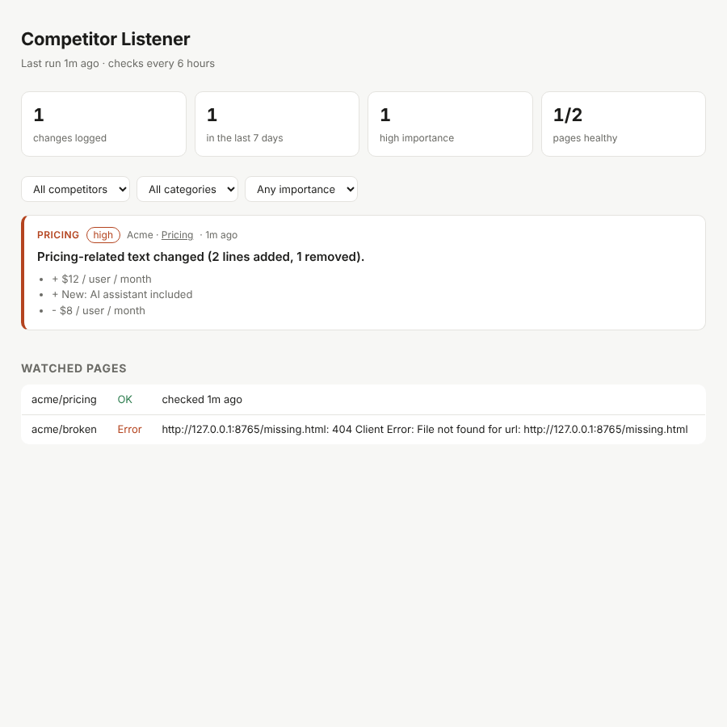
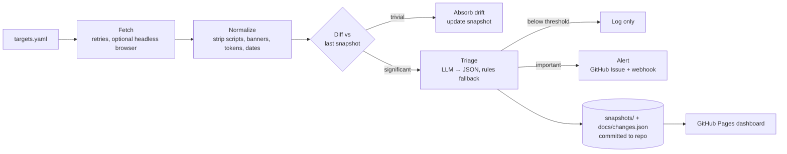

# Competitor Listener

Watches competitor web pages (pricing, features, changelogs) and opens an alert when something **meaningful** changes, with an LLM classifying each change and writing a one-line summary a PM can act on.

Runs entirely on free GitHub infrastructure: **Actions** for the schedule, **Issues** for alerts, **Pages** for the dashboard, and the repo itself as the database.



## How it works



A GitHub Actions cron runs this every 6 hours and commits the results, so **git history is the full audit trail** of every competitor page.

## Quick start

```bash
git clone https://github.com/<you>/competitor-listener && cd competitor-listener
python -m venv .venv && source .venv/bin/activate
pip install -r requirements-dev.txt

pytest -q                      # 18 tests, no network needed
python -m listener.run         # first run saves baselines
python -m listener.run         # later runs detect changes
```

## Test locally before deploying

**1. Unit tests** (no network):
```bash
pytest -q
```

**2. Simulated competitor change** (no network, about 10 seconds). Serves a fake competitor site on localhost, runs the listener, edits the site (a real price change plus pure noise), runs again, and opens the dashboard:
```bash
python scripts/demo.py
```
Set `ANTHROPIC_API_KEY` first to see LLM summaries instead of rule-based ones; set `ALERT_WEBHOOK_URL` and run the real listener to test Slack/Discord delivery.

**3. Real competitor pages.** Run the listener twice in a row:
```bash
python -m listener.run     # saves baselines
python -m listener.run     # should report "no meaningful change" for every page
```
Every page should show `OK` in `docs/changes.json`. If the second run reports a change even though nothing happened, that page has noise to filter: add a `selector` or `ignore` entry for it in `targets.yaml`. Open the dashboard with `python -m http.server -d docs` and visit http://localhost:8000.

To push a clean repo afterwards: `git checkout -- docs/changes.json && git clean -fdq snapshots`.

## Deploy on GitHub (10 minutes)

1. **Push this repo** to GitHub.
2. **Settings → Actions → General → Workflow permissions:** choose *Read and write permissions*.
3. **Settings → Pages:** Source *Deploy from a branch*, branch `main`, folder `/docs`.
4. *(Optional)* **Settings → Secrets and variables → Actions:**
   - `ANTHROPIC_API_KEY`: enables LLM triage. Without it, a rules-based classifier is used.
   - `ALERT_WEBHOOK_URL`: a Slack or Discord incoming webhook.
5. **Actions → Listen for competitor changes → Run workflow.** The first run records baselines; after that, changes show up as Issues and on the dashboard.

## Watching a new competitor

Edit `targets.yaml`. No code changes:

```yaml
competitors:
  - name: Acme
    pages:
      - name: Pricing
        url: https://acme.com/pricing
        selector: "#plans"              # only diff this part of the page
        ignore: [".promo-banner"]       # strip noisy widgets
        render_js: false                # true for client-rendered pages (needs Playwright)
```

## Design decisions

**Noise is the main enemy.** An alert channel that cries wolf gets muted. Filtering happens in three layers:
1. *Normalization* strips scripts, cookie banners, carousels, testimonials, copyright years, clock times and token-like hashes, and collapses whitespace.
2. *Diffing* ignores lines that only moved, and anything under `min_changed_chars`. Any price-looking change bypasses the size threshold, since a `$8 → $10` edit is tiny but important.
3. *Triage* lets the LLM label a change as `noise`, which is logged but never alerted.

**The LLM does one narrow job.** It classifies (`pricing`, `feature`, `positioning`, `legal`, `noise`), rates importance, and summarizes. Output is strict JSON and validated; anything malformed falls back to rule-based triage, so a bad model response can't break a run. Diffs are truncated to about 12k characters, so each call costs a fraction of a cent.

**Failures are isolated.** One broken page (404, timeout, changed layout) is recorded in the dashboard's status table and the run continues. The workflow only fails if *every* page fails, which usually means a config or network problem worth a human look. Permanent errors (4xx) fail fast; transient ones (429, 5xx, timeouts) retry with backoff.

**Layout changes are surfaced, not hidden.** If a configured `selector` stops matching, that's reported as an error instead of silently diffing an empty page.

**The repo is the database.** Snapshots are plain text, so every change is reviewable with `git log -p snapshots/`. No external storage, no cost.

## Project layout

```
listener/
  config.py      load + validate targets.yaml
  fetch.py       HTTP with retries; optional Playwright rendering
  normalize.py   HTML → stable text
  diff.py        line diff, move detection, significance + pricing heuristics
  triage.py      LLM classification with JSON validation and rules fallback
  alert.py       GitHub Issues + Slack/Discord webhook
  store.py       snapshots and change log
  run.py         CLI entry point
scripts/demo.py  simulated end-to-end run with a fake competitor site
docs/            GitHub Pages dashboard (index.html reads changes.json)
snapshots/       committed page snapshots
.github/workflows/
  listen.yml     scheduled run every 6 hours
  test.yml       lint + tests on push
```

## Possible next steps

- Weekly digest email summarizing all changes per competitor
- Screenshot diffs for visual changes (Playwright + pixel diff)
- Per-customer config files so one deployment serves several teams
- Track changes on G2 reviews, job postings, or app-store release notes

## License

MIT
